# Research log

Every experiment that produces images is recorded here, newest last. Each entry says what was tried, shows the results, and states what was learned. The images are tracked in git, so quality can be compared over time.

The test set is the same in every experiment unless an entry says otherwise: four photos and five nature styles from `model/data/` (sources and licences in `model/data/SOURCES.md`).

**Read these first**

- [landscape.md](landscape.md): the methods that exist in 2026, which ones we will test, and in what order.
- [quality-checklist.md](quality-checklist.md): the features of an output image we test and improve one at a time, and where each tested method stands.
- [next-stage.md](next-stage.md): the plan for the next stage, with its goal, steps and measures.

## Quality over time

| # | Date | What was tried | Verdict | Your rating (1 to 5) |
|---|---|---|---|---|
| [000](#000-microast-first-look) | 2026-10-02 | MicroAST with its published weights | Keeps the photo recognisable. Not likable on people and pets: faces turn green or red and a woven artifact appears. Closer on landscapes. | |
| [001](#001-microast-against-the-notebooks-method-stopped-early) | 2026-10-02 | The notebook's optimisation method next to MicroAST. Stopped after one photo. | Real style texture arrives, which MicroAST lacks. Unreliable: one of five styles diverged to a black image. Faces still turn green. | |
| [002](#002-samam) | 2026-10-02 | SaMam (2025), the best published texture-transfer model | **Best so far.** Faces keep natural skin and detail. Sky and lava styles look good on people. Still has a repeating dot pattern in flat areas. | |
| [003](#003-styling-chosen-parts-of-the-photo) | 2026-10-02 | Style applied only to chosen parts: background, hair, clothes | **Works well for a single person.** "Background only" gives the most likable results yet. The parts model is for people only, so it mislabels pets. | |
| [004](#004-nnst-abandoned) | 2026-10-02 | NNST, the modern optimisation method | Abandoned: 515 seconds for one image on this laptop. No images. | |
| [005](#005-removing-samams-stamp-pattern) | 2026-10-02 | Three ways to remove SaMam's repeating stamp pattern | A guided filter removes it completely but also blurs real photo detail. Shift-averaging only softens it. A larger style image makes it worse. | |
| [006](#006-the-enhancer-smooth-the-change-keep-the-photo) | 2026-10-02 | Enhancer, first version: smooth only the change the style made, keep the photo's own detail, add texture back by choice | Artifacts gone, faces and whiskers sharp, style present as colour and tone. Texture by part gives a natural person on a stylized background. | |
| [007](#007-giving-skin-fur-and-hair-their-own-colour) | 2026-10-02 | Skin, fur and hair get their own colour back; animals are now detected | **Colour fixed for detected subjects.** The cat is black and white, the dogs are brown, faces have natural skin. | |
| [008](#008-keeping-things-separate-edge-methods) | 2026-10-02 | Two edge-based ways to stop things merging | Small gains only, and the edge detector failed on rippling water. | |
| [009](#009-everything-together) | 2026-10-02 | All settings together, plus detection of any prominent object and a fixed edge detector | People, pets and objects each stay distinct and natural against a styled background. Now the "protect subjects" option. | |
| [010](#010-style-on-everything-crafted) | 2026-10-02 | Style on every object, faces and pets included, as one even tint per object with the random patches removed | **Current default.** Style on subjects nearly doubled against 009, edges stayed prominent, blotchiness halved. | |
| [011](#011-samams-finer-checkpoint) | 2026-10-02 | SaMam's finer 4-pixel checkpoint as the source | More style on subjects, less prominent edges. Kept as a "stronger style" option. | |
| [012](#012-texture-from-the-style-image-itself) | 2026-10-02 | Our own texture step: the style image's real texture placed inside each part of the photo | **Works for dense textures** (leaves, flowers): the result finally looks made of the style. **Fails for scene styles** (lava, sky, forest), where it reads as a double exposure. Not the default yet. | |
| [013](#013-a-new-edge-number-outline-strength) | 2026-10-03 | Replace the edge prominence number with one that measures outlines only | **Done.** The old number scored a blurred result higher than a sharp one. The new one ignores texture inside objects and drops clearly when the result is blurred. No images. | |
| [014](#014-texture-style-or-scene-style) | 2026-10-03 | Decide per style how much of the style sheet it gets, from how much its colour varies across the image | **Works on the five styles:** autumn gets the full sheet, flowers two thirds, forest a third, lava and sky none. The forest's tree trunks and lava's red dots are gone. Set from five styles only. | |
| [015](#015-keeping-the-photos-colour-mood) | 2026-10-03 | Keep the photo's own colours and overall mood, with the style adding texture only (founder's request) | **The mood is kept** with C (own colour and brightness): faces natural, a dark photo stays dark. **The cost:** scene styles all but vanish, since their style is colour, and texture is weaker. An option, pending the founder's choice. | |
| [016](#016-the-styles-pattern-not-the-whole-picture) | 2026-10-03 | Build the style sheet from the square of the style image most evenly full of detail (its pattern), not the whole picture | **Scene styles now give a pattern** (lava's spatter, the lupin bed), and texture likeness reaches 0.37. The squares still catch some trunks and rock, and a small square repeats visibly. | |
| [017](#017-the-pattern-on-chosen-parts-in-its-own-colours) | 2026-10-03 | The pattern in its own colours on chosen parts of the photo, the photo's own colours everywhere else, no tint over the whole photo, and no model (founder's direction) | **Closest to the product idea yet on portraits:** a person in their own colours in front of a meadow, forest or lava. Open: visible repetition, faint pattern on pets, a dark halo along outlines, and nothing chosen on landscapes. | |

The verdict column is Claude's reading of the images. The rating column is for the people the product is for, starting with you.

---

## 000: MicroAST first look

**Question.** How does the smallest candidate model look on our own photos and nature styles, before any training of our own?

**Setup**

| | |
|---|---|
| Model | MicroAST, the authors' published weights (trained on paintings), 471,987 parameters |
| Size | Photos and styles resized to 512px high |
| Strength | Full |
| How it ran | ONNX export from `model/export_onnx.py`, on CPU |

**Results.** Each sheet shows the photo, the style and the result, one row per style.

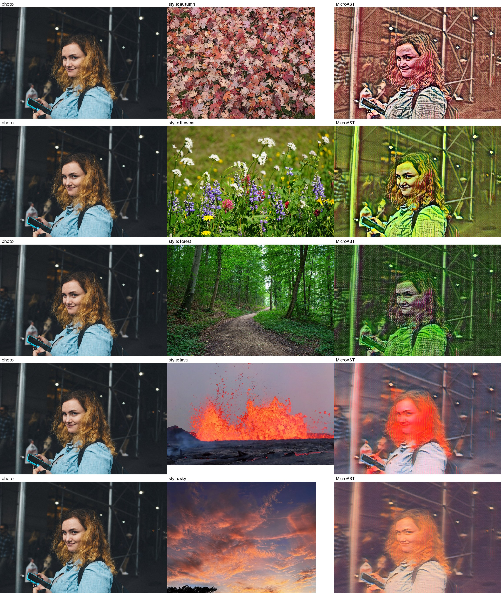

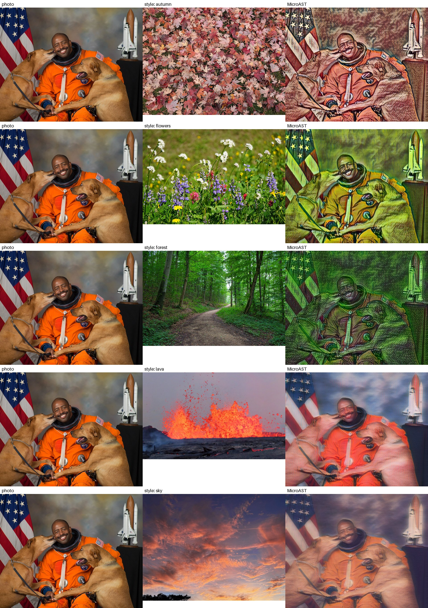

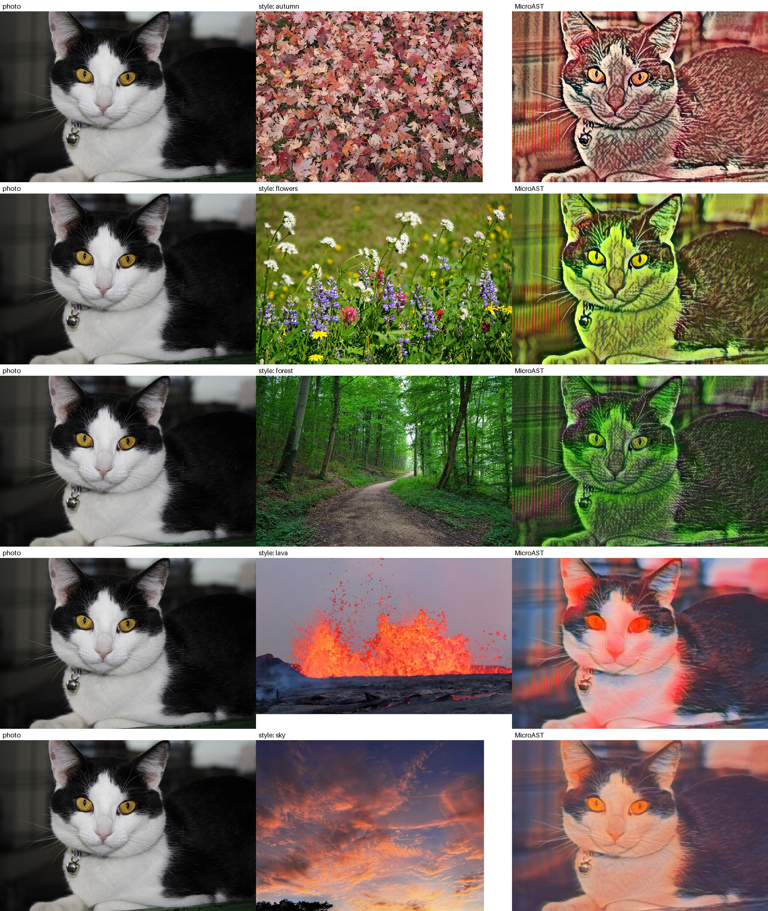

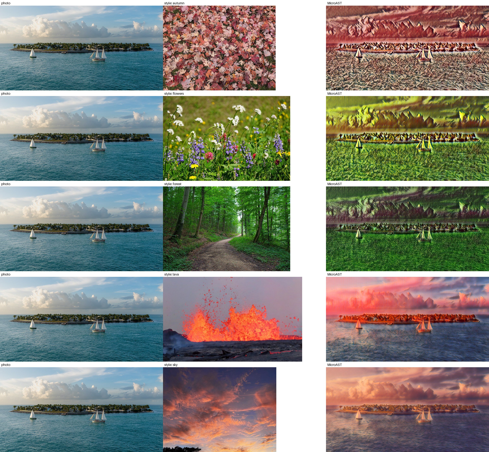

**What the images show**

- **The photo stays recognisable in every result.** Faces, the dogs, the cat, the flag and the boats keep their shapes. This is the promise the product depends on, and it holds.
- **On people and pets it mostly transfers colour.** Flowers and forest turn faces and fur green. Lava turns skin pink-red and gives the cat glowing red eyes. Little of the style's texture arrives.
- **Skin and fur tones are wrecked** in the flowers, forest and lava rows.
- **A woven or plaid artifact** covers flat and blurred areas, most visibly behind the cat and the portrait.
- **The landscape works better than the faces.** On the harbour, the sea picks up a leaf-like texture in the autumn, flowers and forest rows, and the sky row gives a believable warm sunset.
- **Autumn is the most artistic style.** It reads as a red-toned sketch on every photo.
- **Sky is the most pleasant style.** It acts as a warm colour grade and does no damage, though it adds little.
- **Lava is the weakest on faces** and reasonable on the harbour, where it gives a pink sky.

**Conclusion.** With its published weights, MicroAST is far from the "liked at first look" goal for photos of people and pets, which are the photos the product is mainly for. It is closer on landscapes. Part of this was expected, since those weights were trained on paintings. The images do not yet tell us whether the fault is the training data or the model's small size.

**Two things worth carrying forward**

- A "keep my photo's colours" option would remove the worst failure here, the green and red faces.
- The style image matters as much as the model. A dense, even texture (autumn leaves) transfers far better than a scene with a subject and a background (lava fountain, forest path).

**Next.** Experiment 001 runs the notebook's optimisation method on the same photos and styles.

---

## 001: MicroAST against the notebook's method (stopped early)

**Question.** Does the notebook's optimisation method, the original technique in this family, give likable results on our photos and nature styles?

**Status.** Stopped after one photo out of four. The method takes about 165 seconds per image, so the full run needed an hour, and the question itself was superseded: the notebook's method is from 2015 and newer methods exist that should be tested first. See [landscape.md](landscape.md).

**Setup**

| | |
|---|---|
| Method | Port of the original notebook (since removed from the repo, along with this port): same VGG19 layers, same weights (content 1e5, style 1e8, smoothing 1e-4), L-BFGS, 1,000 steps, starting from the photo |
| Size | 512px high |
| Hardware | RTX 3050, about 165 s per image |

**Result**

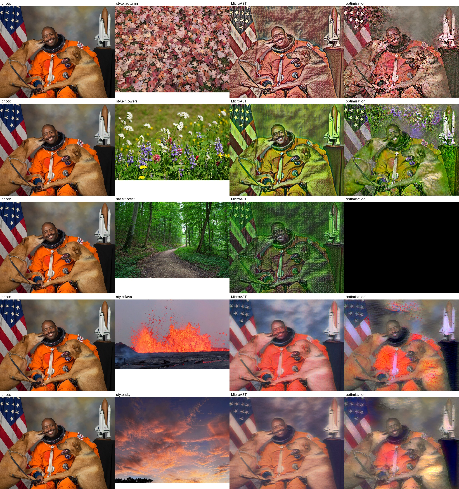

The columns are photo, style, MicroAST, and the notebook's method.

**What the image shows**

- **Real texture arrives.** In the flowers row, purple flowers appear in the background. In the autumn row, leaves do. MicroAST only tinted the photo.
- **The forest row is black.** The optimisation diverged and returned an invalid image. A second run diverged after 6 steps. With these settings the method is not stable for every style image.
- **The face still turns green** in the flowers row and darkens in the autumn row.
- **The lava row is speckled** with red dots across the dog and the suit.
- **The sky row is a soft glow**, similar to MicroAST's and no better.

**Conclusion.** The notebook's method carries more of the style than MicroAST and fails the same two tests that matter most for personal photos: skin colour and artifacts. It is also slow and unreliable. Tuning it further is not the best use of time while better methods are untested.

**Carried forward**

- `model/compare.py` now keeps the best image seen and stops cleanly if the optimisation diverges.
- The checklist in [quality-checklist.md](quality-checklist.md) starts from what these two experiments exposed.

**Next.** The test plan in [landscape.md](landscape.md): the newer texture-transfer methods, starting with SaMam, on the same test set.

---

## 002: SaMam

**Question.** Does the best published texture-transfer model do better than MicroAST on our photos and nature styles?

**Setup**

| | |
|---|---|
| Model | SaMam, the authors' published weights (`SaMam_patchsize_x8.ckpt`, trained on paintings), 18.5 million parameters |
| Size | Photo 512px high; style resized so its shorter side is 256px, as the authors do |
| Hardware | RTX 3050. 9 to 52 seconds per image using the slow pure-PyTorch path. The authors report 0.034 s on an RTX 3090 with their compiled path, which we have not set up. |
| Command | `compare.py 002-samam samam,microast` |

**Results.** Columns are photo, style, SaMam, MicroAST.

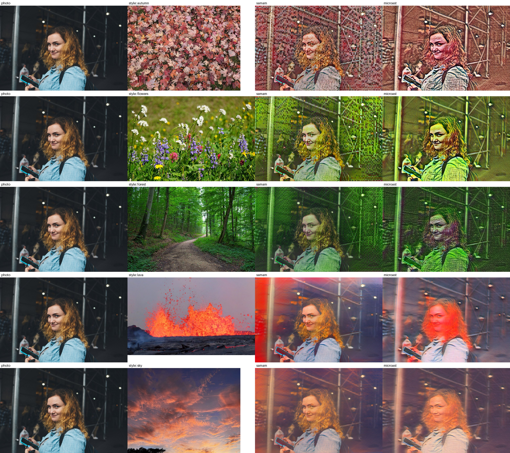

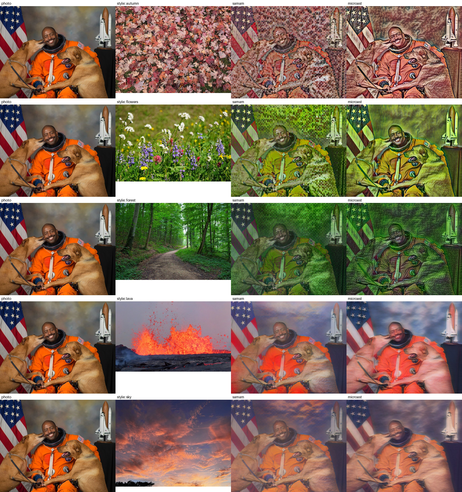

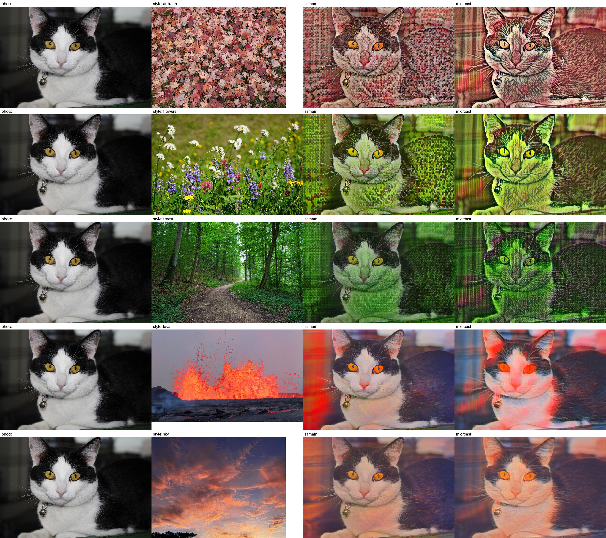

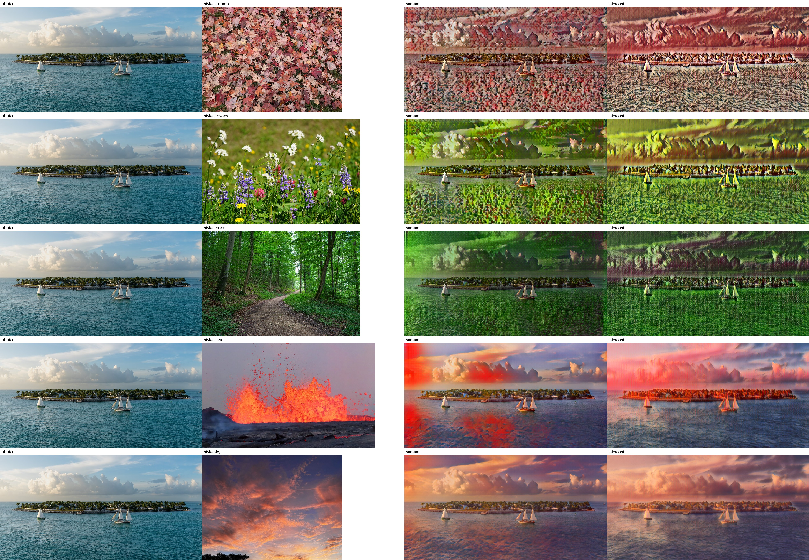

**What the images show**

- **Faces keep a natural skin tone and their detail.** In every row the woman and the astronaut look like themselves, where MicroAST turned them green or red. This is the largest improvement so far.
- **The style lands mostly on the background and clothes.** The subject is styled more lightly than its surroundings, which suits personal photos.
- **Sky and lava look good on people and on the cat.** They read as the same photo in warm evening light.
- **The harbour with the sky style is the best single result so far.** Autumn on the harbour gives a rich leaf-textured sea.
- **A repeating dot pattern covers flat areas** in the autumn, flowers and forest rows. It sits on an 8-pixel grid, which is the model's patch size.
- **Lava leaves red blobs** near the image edges and across the harbour's sky and sea.
- **White fur still turns green** on the cat with flowers and forest.
- **A thin line runs along some image borders.**

**Conclusion.** SaMam is the leading candidate. It passes the likeness and skin-colour tests that MicroAST and the notebook's method failed. Its remaining problems are artifacts: the dot pattern, the lava blobs and the border line. Those are what the enhancer is for.

**Next.** Test the remaining candidates (NNST, AesPA-Net, AdaAttN, CAP-VSTNet, StyTr2) on the same set, then start on the artifact clean-up with the best one or two.

---

## 003: Styling chosen parts of the photo

**Question.** Can the style be applied only to the parts a person chooses, such as the background or the hair?

**How it works**

1. A small model labels every pixel as background, hair, face skin, body skin, clothes or accessories. This is a classifier, so it invents nothing.
2. The photo is stylized once, as usual.
3. The stylized image and the original are blended through a mask of the chosen parts.

Choosing a different part only repeats step 3, so it is instant.

**Setup**

| | |
|---|---|
| Parts model | MediaPipe `selfie_multiclass_256x256` (Apache-2.0, 16.4 MB), built for photos of people |
| Style model | SaMam, as in experiment 002 |
| Command | `regions.py 003-region-styling` |

**Results.** Columns are the photo, the detected parts, then the style applied to: the whole photo, background only, hair only, clothes only, and everything except face and skin.

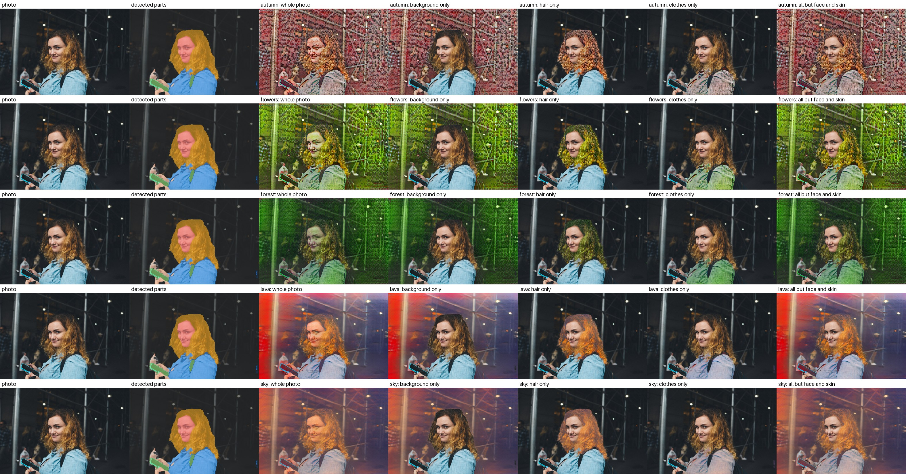

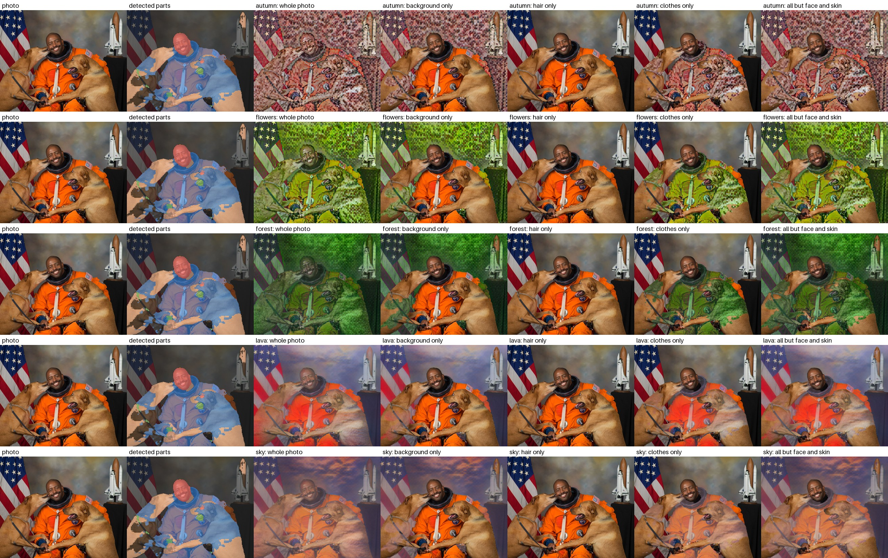

**What the images show**

- **On the portrait the parts are found cleanly**: hair, face, jacket, hands and phone are each separated from the background.
- **"Background only" is the most likable result so far.** The person is untouched and natural, and the scene behind is transformed.
- **"Hair only" works** and gives a playful result: autumn-red or green hair with everything else unchanged.
- **"Everything except face and skin"** keeps the person recognisable with a natural face while styling the rest.
- **On the astronaut photo the dogs are mislabelled.** The model only knows people, so it marks parts of the dogs as clothes, hair or background. "Background only" then leaves blotchy styled patches on the dogs.
- **Mask edges are blocky** where the labels are uncertain, because the model works at 256 pixels.

**Conclusion.** The feature is feasible, cheap to run, and fits the no-generative rule. For photos of one person it also solves the skin-colour problem outright, since the face can simply be left alone. It needs two things before it is product quality: a way to select pets and objects, and cleaner mask edges.

**Carried forward**

- Leaving face and skin unstyled is a strong candidate for the default on photos with people.
- Mask edges should be refined using the photo's own edges. This is the same guided-filter technique planned for the enhancer.
- Pets and objects need a general "tap to select" segmenter. Small ones that run in a browser exist and are to be evaluated.

---

## 004: NNST (abandoned)

**Question.** Is NNST, the modern replacement for the notebook's optimisation method, a better base than SaMam?

**Result.** One image took 515 seconds on the RTX 3050, with the GPU's memory full. The run was stopped before a sheet was saved, so there are no images.

**Conclusion.** At over eight minutes per image it cannot be iterated on here, and as an optimisation method it could never be the product's engine. Dropped. `compare.py` still has the `nnst` method if a faster machine is available later.

Two other candidates were ruled out at the same time without a run:

- **AesPA-Net** has no licence file, so it could not be used in a commercial product without the authors' permission.
- **SaMam's 4-pixel checkpoint** runs out of memory on a 6 GB GPU at our image size with the pure-PyTorch path.

---

## 005: Removing SaMam's stamp pattern

**Question.** Checklist item Q5. SaMam tiles flat areas with a repeating mark. Which fix removes it using only the photo and the result?

**What the artifact is.** At full size the background is covered by a regular lattice of small dark hook shapes: the model stamps a similar mark onto each 8-pixel patch. Close up, it also leaves crackle marks on faces and around eyes, which the full sheets in experiment 002 hid.

**Setup**

| Fix | How it works | Cost |
|---|---|---|
| Shift-average | Run the model on four slightly shifted copies of the photo and average them. A pattern locked to the patch grid lands somewhere else each time and cancels. | Four model runs |
| Guided filter | Smooth the result where the original photo is smooth; leave it alone at the photo's edges | Negligible |
| Larger style image | Feed the style at 512px instead of 256px | None |

Three pairs chosen to expose the problem: portrait with autumn, cat with flowers, harbour with lava. Command: `enhance.py 005-artifacts artifacts`.

**Results.** Each close-up sheet shows two 200-pixel regions at double size.

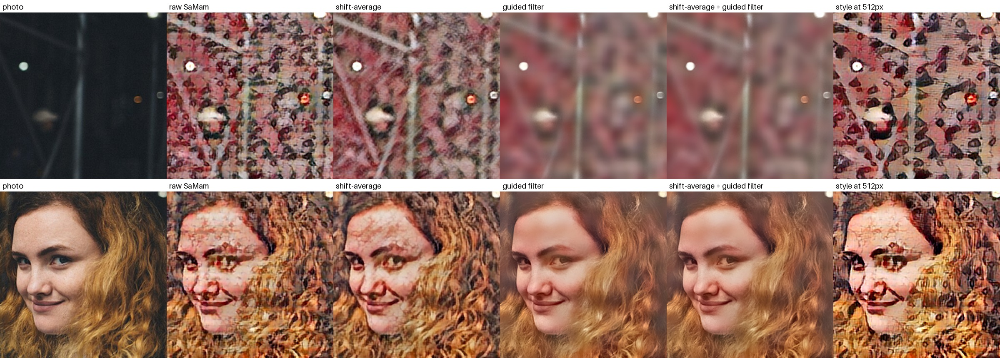

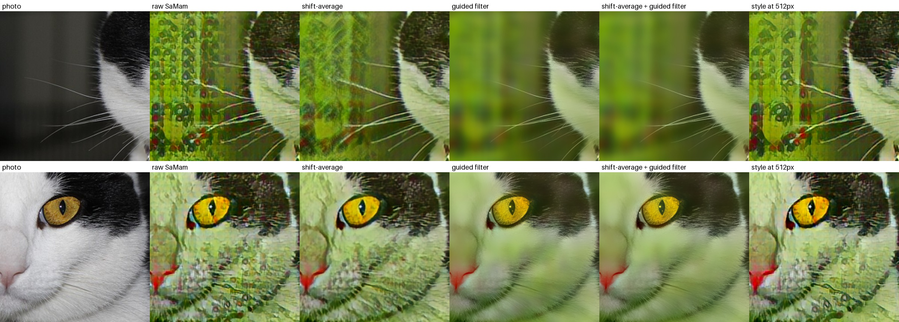

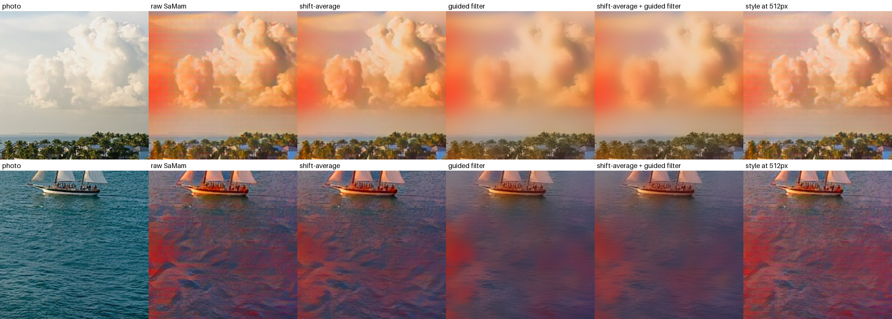

Full images: [portrait](005-artifacts/portrait_autumn.jpg), [cat](005-artifacts/cat_flowers.jpg), [harbour](005-artifacts/harbour_lava.jpg).

**What the images show**

- **The guided filter removes the stamps completely** and leaves a clean face.
- **It also removes real detail.** The cat's whiskers fade, the clouds lose their shape, the waves flatten, and the face looks airbrushed. That breaks the rule that the photo's detail must survive.
- **Shift-averaging softens the stamps** into a more organic mottled texture without removing them.
- **A larger style image makes the stamps bigger and harsher.** Rejected.
- **The red blobs from the lava style survive every fix.** They are large patches of colour, not fine artifacts.

**Conclusion.** The guided filter is the right tool aimed at the wrong thing. Smoothing the whole stylized image throws away the photo's detail with the artifact.

**Next.** Smooth only the change the style made.

---

## 006: The enhancer: smooth the change, keep the photo

**Question.** Can the artifacts be removed without losing any of the photo's own detail?

**The idea.** Treat the style as a change made to the photo:

1. `change = stylized result - photo`
2. Smooth the change, using the photo's edges as the guide.
3. `enhanced = photo + smoothed change`

The photo itself is never filtered, so its detail is intact. Nothing is used except the photo and the result.

One setting, **texture**, returns a chosen share of what the smoothing removed. At 0 the result is fully clean. At 1 it is the raw model output. The setting can be a single number or differ per part of the photo.

**Setup**

| | |
|---|---|
| Source | SaMam, shift-averaged, so any texture that is returned is the organic kind |
| Texture by part | Background 1.0, clothes and accessories 0.6, hair 0.3, face and skin 0. Used when a face is found. |
| Command | `enhance.py 006-texture texture`. Runs in seconds from cached model results. |
| Built-in check | Texture 1 must return the raw result exactly, and an unchanged photo must stay unchanged |

**Results**

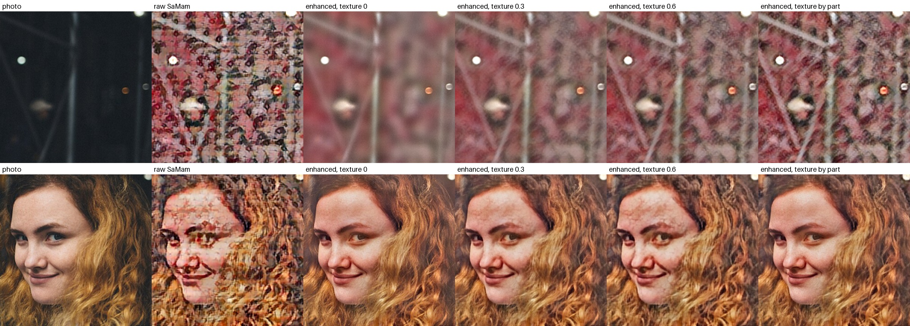

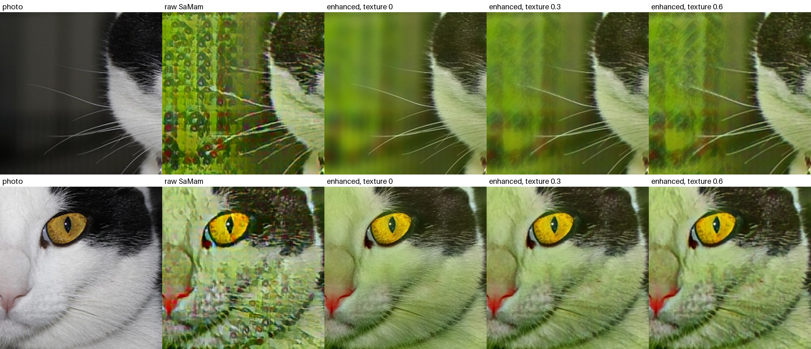

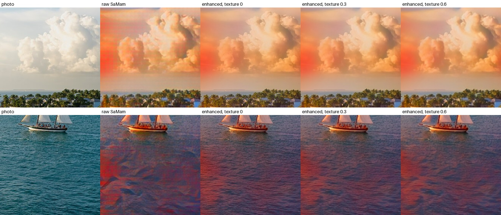

Full images: [portrait](006-texture/portrait_autumn.jpg), [cat](006-texture/cat_flowers.jpg), [harbour](006-texture/harbour_lava.jpg).

**What the images show**

- **At texture 0 the artifacts are gone and the detail is back.** The woman's freckles, the cat's whiskers and eye, the cloud shapes and the real waves are all sharp. Compare with the airbrushed look in experiment 005.
- **The style survives as colour and tone.** The harbour with lava reads as a believable sunset photograph. The portrait reads as a clean photo in a red-toned scene.
- **Texture is a smooth dial.** At 0.3 a light pattern returns. At 0.6 crackle is visible on the face again.
- **Texture by part is the best portrait result so far.** The face is clean and sharp, the hair is lightly textured, and the background carries the full style texture.
- **Still wrong: white fur is green** on the cat. The enhancer keeps detail; it does not correct colour.
- **Still wrong: the lava style's red blob** remains at the left of the harbour, though it now passes for sunset glow.
- **At texture 0 flat backgrounds look soft**, like a blurred backdrop.

**Conclusion.** This is the enhancer's first working version. It fixes artifacts (Q5) and fine detail (Q8) together, and it cannot invent anything, because every pixel comes from the photo plus a smoothed version of the model's change.

**Carried forward**

- "Texture" is a candidate for a control the visitor sees, next to strength.
- Shift-averaging is only worth its four model runs where texture is kept. For a fully clean result one run is enough.
- Next on the checklist is colour: the green fur and tinted faces (Q4).

---

## 007: Giving skin, fur and hair their own colour

**Question.** Checklist item Q4. Can faces and fur keep their real colour while the rest of the photo takes the style's colour?

**How it works**

- **Own colour.** For a chosen part, the photo's colour is put back and the result's brightness is kept. The amount can be anything from none to all.
- **Finding animals.** The people-only model in experiment 003 called the dogs "clothes". A second model (torchvision's DeepLabV3, which knows cats, dogs, birds, horses, cows and sheep) now overrides it wherever it sees an animal.
- **Cleaner part boundaries.** Part masks are refined with the photo's own edges, replacing the blocky edges seen in experiment 003.

**Setup**

| | |
|---|---|
| Own colour by part | Face, skin and animals: all. Hair: half. Clothes and background: none. |
| Pairs | Cat, portrait and astronaut, each with the flowers style, which turned them green |
| Command | `enhance.py 007-colour colour` |

**Results**

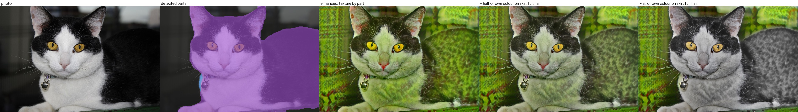

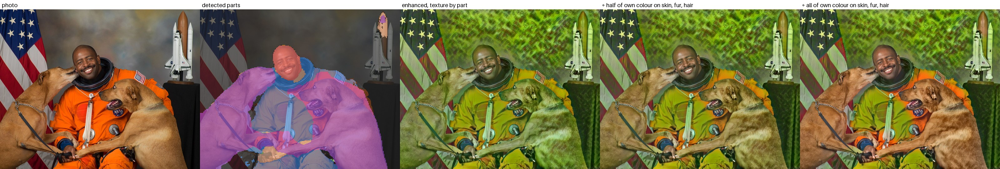

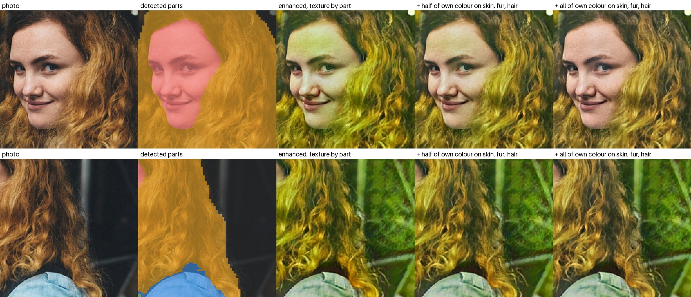

Also: [portrait full](007-colour/portrait_flowers.jpg), [cat close-ups](007-colour/cat_flowers_closeups.jpg), [astronaut close-ups](007-colour/astronaut_dogs_flowers_closeups.jpg).

**What the images show**

- **The cat is black and white again**, against a green styled background.
- **Both dogs are found and are brown again.** The astronaut's face is natural. His suit takes the style's colour, as clothes are meant to.
- **The woman's face has its natural skin tone.** Her hair keeps half its colour and sits between natural and styled.
- **A side effect helps separation.** Because subjects keep their own colour and the background does not, each subject stands clearly apart from what is behind it.
- **Half of own colour is a weak middle.** Faces still look tinted. All of it looks right.
- **Small detection slips remain.** The top of the model shuttle is marked as an animal part.

**Conclusion.** Colour is solved for anything the detectors recognise: people and common animals. It does nothing for other objects, which leads to experiment 009.

---

## 008: Keeping things separate, edge methods

**Question.** Checklist item Q3a. With strong texture, do edge-based methods keep each thing distinct?

**Setup.** Texture set to 0.6 everywhere, to provoke merging. Two methods, alone and together:

| Method | How it works |
|---|---|
| Texture kept off the edges | Find the boundaries between things in the photo and remove texture in a thin band along them |
| Photo's light and dark kept | Take away 70% of the brightness shift the style made, so areas that differed in brightness still differ |

Pairs: astronaut, portrait and harbour, each with the autumn style. Command: `enhance.py 008-edges edges`.

**Results**

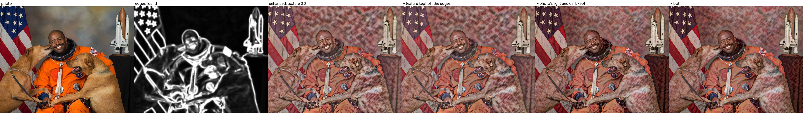

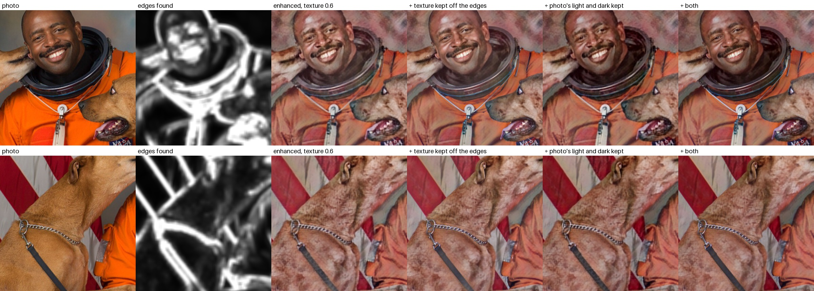

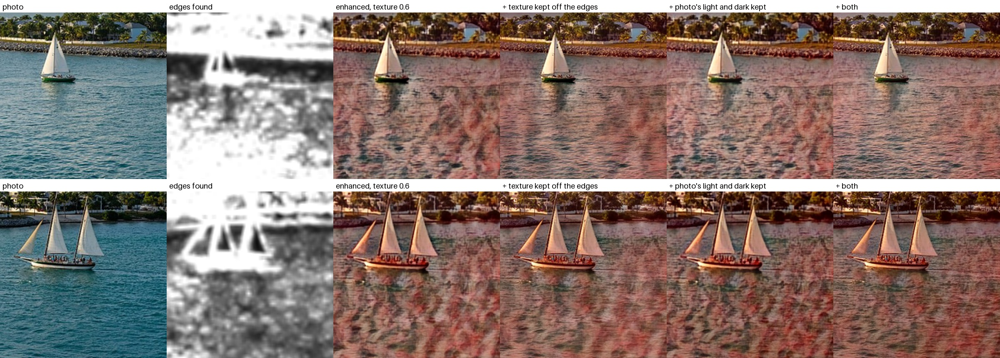

Also: [portrait](008-edges/portrait_autumn.jpg), [portrait close-ups](008-edges/portrait_autumn_closeups.jpg), [harbour](008-edges/harbour_autumn.jpg).

**What the images show**

- **The enhancer alone already keeps outlines.** Even before either method, the astronaut, dogs, flag and shuttle have crisp edges, because the photo's detail is never filtered.
- **Keeping texture off the edges gives a small gain**: cleaner outlines around the dog and collar, and less texture on the face.
- **Keeping light and dark gives a small gain**: dark things stay dark, so there is more contrast between neighbours.
- **Things still share one reddish tone.** The dogs, suit and background remain close in colour, which is the real cause of the merged look.
- **The edge detector failed on the harbour.** It marked nearly the whole sea as edge, because it measured edges relative to the image and the ripples dominated.

**Conclusion.** Edge methods are worth keeping and are not enough. Things merge mainly because they are all given the same colour and texture, so the stronger fix is to treat each thing as its own part.

**Carried forward**

- Fix the edge detector: measure at a coarser scale and on an absolute scale.
- Detect prominent objects of any kind, so they can keep their own colour as people and animals do.

---

## 009: Everything together

**Question.** With all the settings from 006 to 008 applied automatically, do people, pets and objects each stay distinct?

**What is new**

- **Any prominent object is found.** A third small model (U²-Net's small version, Apache-2.0, 4.7 MB) marks whatever stands out in the photo. Anything it finds that is not already a person or an animal becomes an "object" part.
- **The edge detector is fixed.** It now measures at quarter size, where ripples and fur average away, and on an absolute scale.
- **One function applies everything**: `enhance_auto()` in `model/enhance.py`.

**Settings**

| Part | Texture | Own colour kept |
|---|---|---|
| Face and skin | 0 | all |
| Animal | 0.3 | all |
| Object | 0.3 | 0.7 |
| Hair | 0.3 | half |
| Clothes, accessories | 0.6 | none |
| Background | 0.6 | none |

Texture is also removed along the boundaries between things, and half of the photo's own light and dark is kept.

**Results: three check pairs.** Columns are the photo, the detected parts, the edges found, raw SaMam, and the enhanced result.

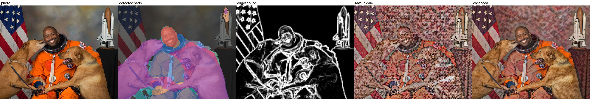

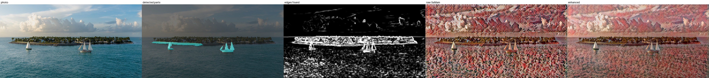

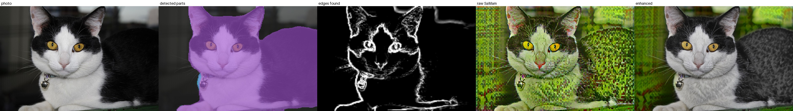

Close-ups: [astronaut](009-enhanced/astronaut_dogs_autumn_closeups.jpg), [harbour](009-enhanced/harbour_autumn_closeups.jpg), [cat](009-enhanced/cat_flowers_closeups.jpg).

**What the images show**

- **The astronaut photo is transformed.** Raw SaMam is one patterned red mass. Enhanced, the face is natural, both dogs are brown and distinct from the suit, the flag and shuttle are crisp, and the background carries the leaf texture.
- **Both boats in the harbour are found as objects.** They keep their own colour and stand out against the textured sea.
- **The edge map is now clean**: outlines of things, with only light speckle left on the water.
- **The cat is natural and sharply outlined** against a green styled background.
- **Still imperfect:** the cat's dark fur shows a faint dotted pattern, and part of the harbour's shoreline is marked as an object.

**Results: all 20 pairs.** Columns are the photo, the style, raw SaMam, and the enhanced result.

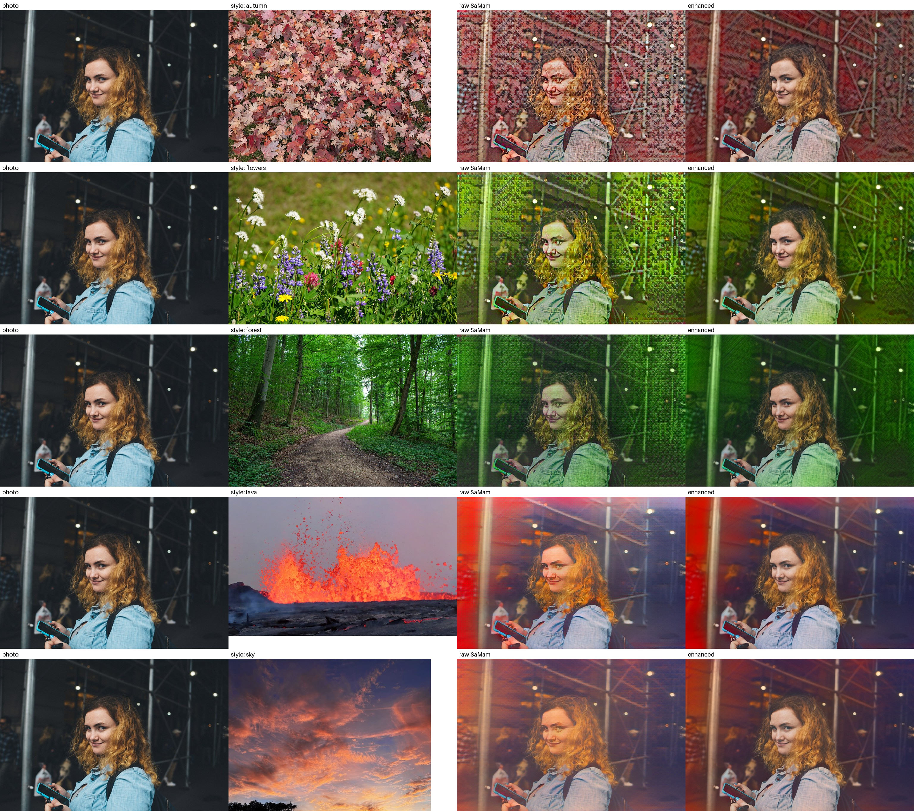

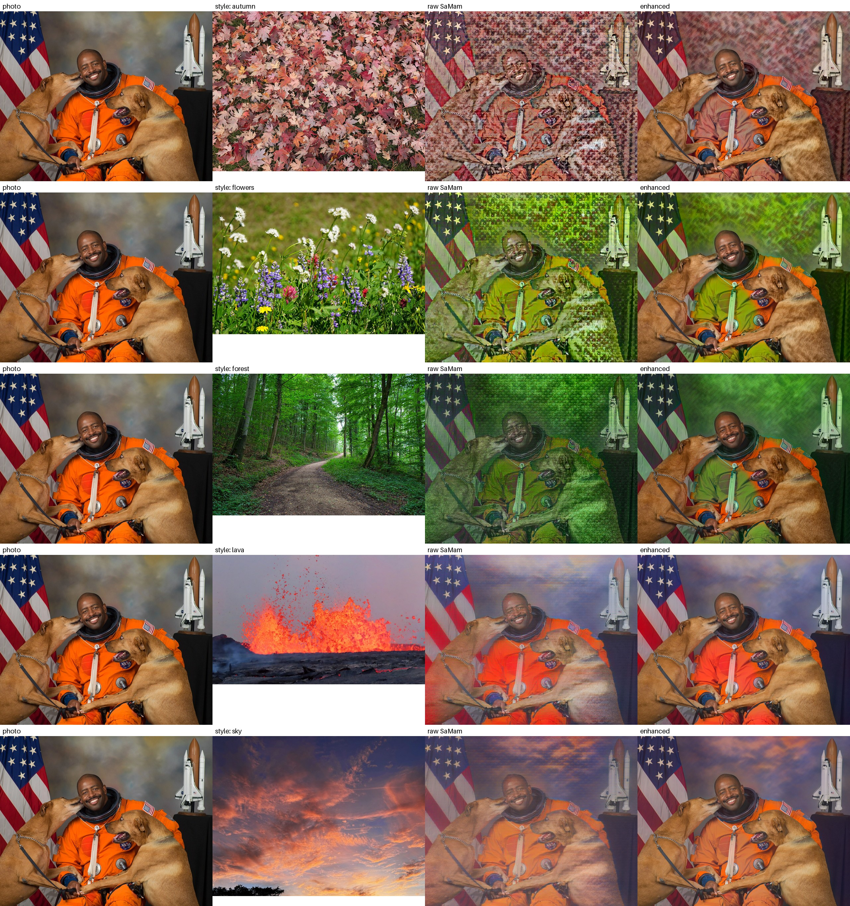

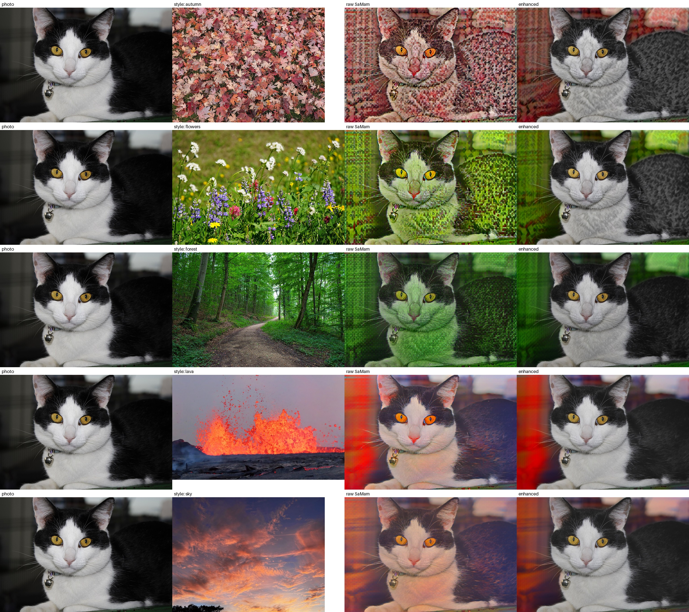

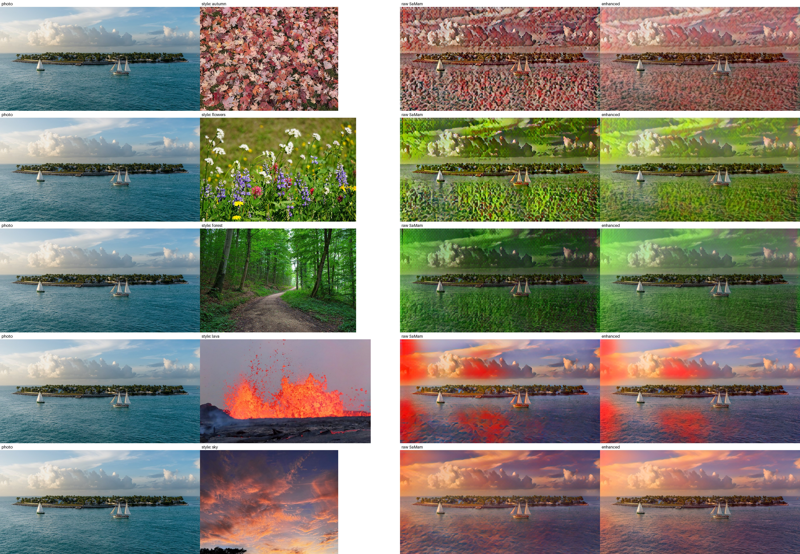

**What the full set shows**

- **The enhanced result beats raw SaMam in all 20 pairs.** Faces, the dogs and the cat are natural in every row, and the stamp pattern is gone or much reduced.
- **Sky is the most consistently pleasing style**, and autumn gives the richest background texture.
- **Flaw: uneven colour on the astronaut's suit.** In the flowers and forest rows, a patch of the suit next to each dog stays orange while the rest turns green. The boundary between "clothes" and "animal" is uncertain there, and the two parts are given different colour rules.
- **Flaw: a visible seam in the harbour's sea.** In the flowers row, the left part of the sea is flatter than the right. The object detector marked a strip of shoreline and water as an object, so that strip got less texture and more of its own colour.
- **Flaw: the lava style's red patches remain** on the portrait, the cat and the harbour.
- **Hair with half its own colour looks slightly tinted** in the flowers and forest rows.
- **The cat's dark fur shows a dotted pattern** in the autumn and flowers rows.

**Conclusion.** Treating each thing as its own part is what keeps things separate. Edges alone were not enough; parts plus edges are. The cost is that every detection mistake now shows up as a visible patch or seam, so detection quality has become the limit.

**Carried forward**

- Where two parts meet and the detectors are unsure, their settings should blend gradually instead of switching.
- An object should only count when the detector is confident and the region is compact. A strip of shoreline should not qualify.
- These settings are a first guess made by eye on a few pairs. They need rating by people.

---

## 010: Style on everything, crafted

**Goal, set by the founder.** The style should reach every object, faces and pets included. Each thing should keep a crisp outline, stay distinct from its neighbours, and look as if it was made that way, with no random pattern laid over it. Protecting subjects (experiment 009) becomes an option, not the default.

**How success is measured.** Four numbers, averaged over all 20 pairs:

| Number | Meaning | Wanted |
|---|---|---|
| Style on subjects | Average colour change on people, animals and objects, 0 to 100 | High |
| Style on the rest | The same on everything else | High |
| Edge prominence | How much the boundaries between things stand out against the clutter inside them, relative to the photo | Near 1.0 |
| Blotchiness | Size of the mid-sized patches in the change | Low |

**First try: turn the settings up.** More texture and less own colour on subjects, with 70% of the photo's light and dark kept.

- It failed. Style on subjects rose only from 5.7 to 7.6.
- The dogs and the cat came out with pink blotches like a rash.

**Diagnosis.** The random look is not the fine stamp pattern, which was already controlled. It is patches of colour 30 to 60 pixels across that the model places arbitrarily. The clean-up worked at a 13-pixel scale and was too fine to touch them.

**Fix: split the model's change into three scales.**

| Scale | What it is | Treatment |
|---|---|---|
| Even | One tint per object, varying only with that object's own shading | Kept in full |
| Mottle | The arbitrary mid-sized patches | Removed |
| Fine | The stamp texture | Kept by setting, per part |

Each scale follows the photo's edges, so a tint stops at an object's boundary.

**Settings (`CRAFTED` in `model/enhance.py`)**

| | |
|---|---|
| Texture by part | Background 0.6, clothes 0.5, object 0.4, hair 0.35, animal 0.3, body skin 0.2, face 0.15 |
| Own colour kept | None |
| Photo's light and dark kept | 30% |
| Mottle | 0 |

**Measurements**

| Version | Style on subjects | Style on the rest | Edge prominence | Blotchiness |
|---|---|---|---|---|
| Raw SaMam | 13.8 | 18.6 | 0.59 | 2.35 |
| Subjects protected (009) | 5.7 | 12.3 | 0.87 | 1.39 |
| First try | 7.6 | 10.8 | 0.86 | 1.29 |
| **Even tint per object** | **10.0** | **14.1** | **0.88** | **0.72** |

Against 009, style on subjects rose by 75%, edge prominence held, and blotchiness halved. Against raw SaMam, about three quarters of the style is kept while edges are half again as prominent.

**Results: five pairs.** Columns are the photo, raw SaMam, the first try, the even tint, the even tint with a third of the patches returned, and the even tint with outlines.

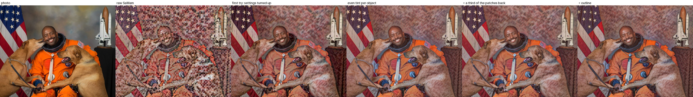

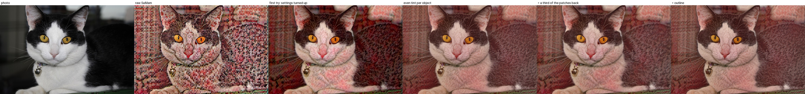

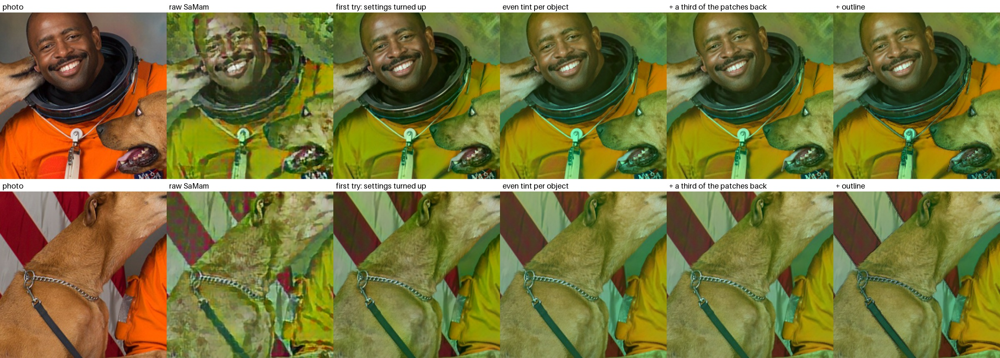

Also: [astronaut flowers](010-crafted/astronaut_dogs_flowers.jpg), [portrait flowers](010-crafted/portrait_flowers.jpg), [harbour flowers](010-crafted/harbour_flowers.jpg), and close-ups for each pair in the same folder.

**Results: all 20 pairs.** Columns are the photo, the style, raw SaMam, subjects protected, and style on everything.

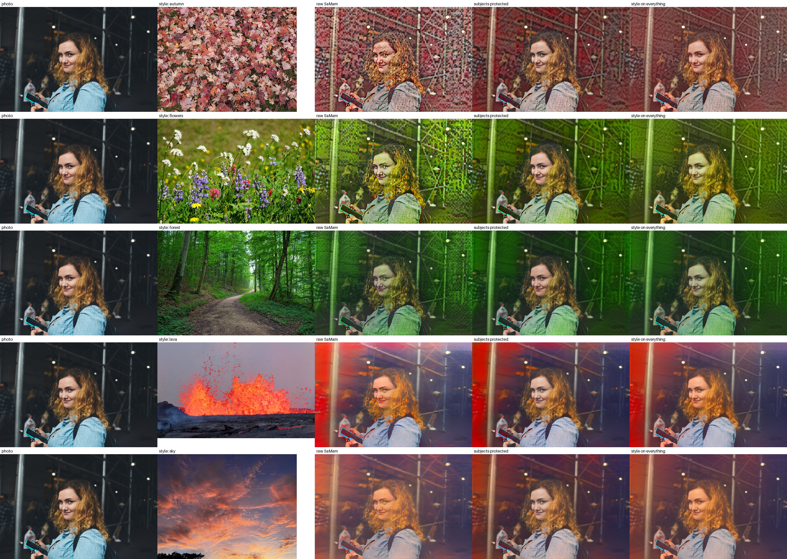

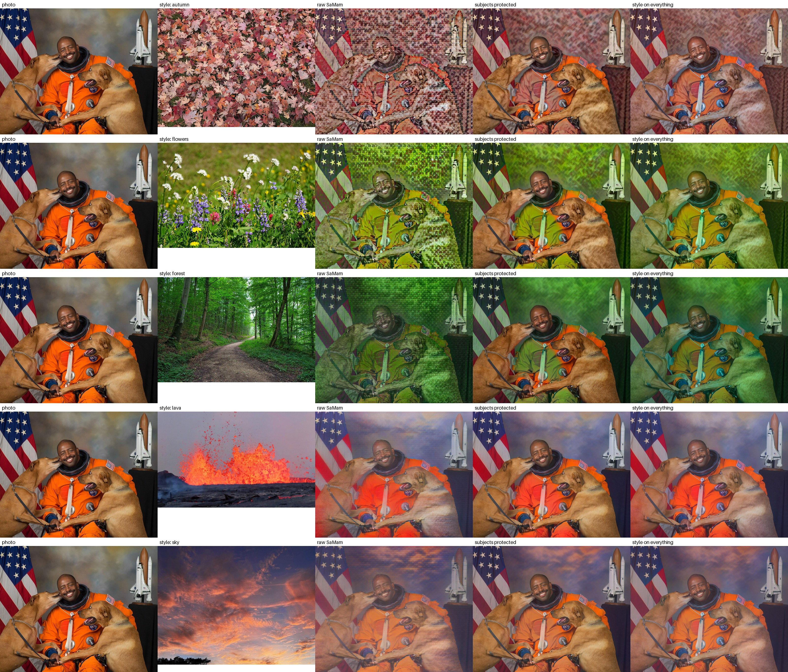

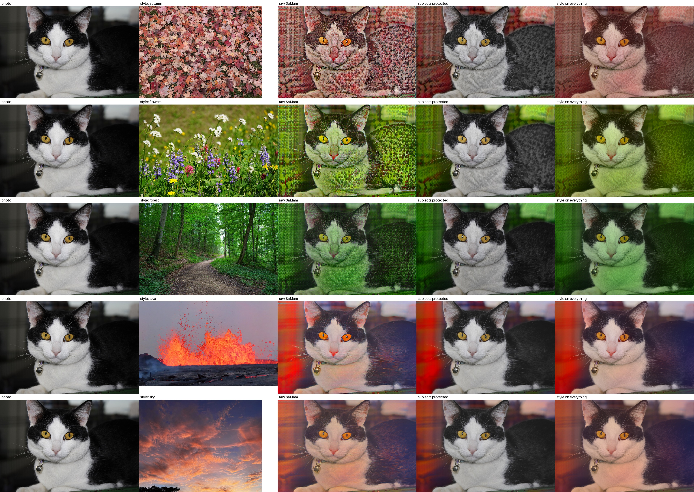

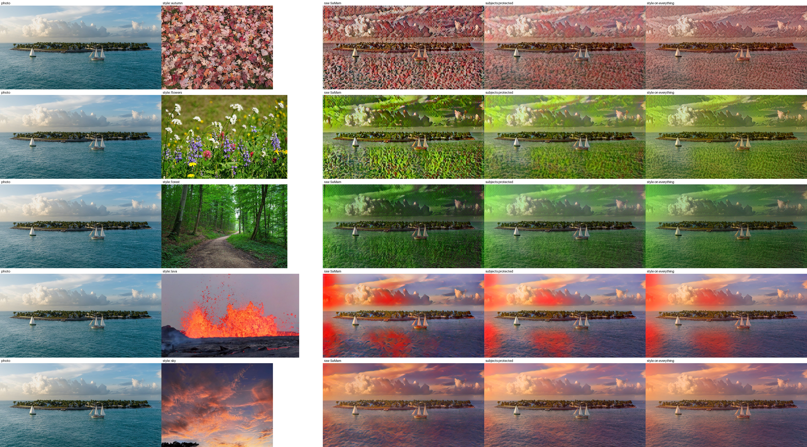

**What the images show**

- **The blotches are gone.** The dogs and the cat carry one even tint that follows their own shading.
- **Faces are styled and still sharp.** With the flowers style the astronaut's face is olive-toned, evenly, with every feature intact.
- **Things are distinct.** Dogs, suit, flag, shuttle and background each read as separate.
- **Both flaws from experiment 009 are gone.** The orange patch on the suit beside the dogs and the seam in the harbour's sea came from treating parts very differently. Parts are now treated alike, so detection mistakes no longer show.
- **Outlines add little and need care.** A drawn line along boundaries is visible on the helmet and collar. It is left off by default and kept off faces, where a line reads as a wrinkle.
- **Still wrong: the lava style's red patches.** They are larger than the scale that is removed.
- **A consequence of the goal:** green styles give green-toned faces and fur. That is what "style on everything" means; the protect option exists for people who do not want it.

**Conclusion.** The goal is met on the measures chosen: style reaches every object, edges stay prominent, and the random patches are removed.

---

## 011: SaMam's finer checkpoint

**Question.** Does SaMam's 4-pixel checkpoint give a texture that reads as deliberate on faces and fur? It was out of reach until the speed fix described below, because it ran out of GPU memory.

**Result**

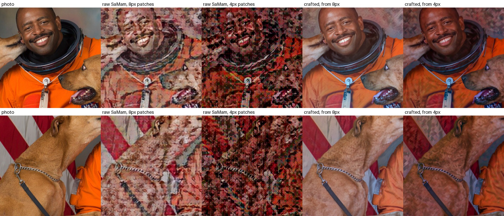

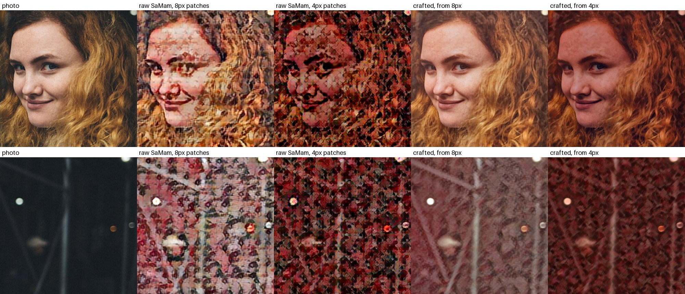

Also: [cat](011-finer/cat_flowers.jpg), [astronaut](011-finer/astronaut_dogs_autumn.jpg), [portrait](011-finer/portrait_autumn.jpg).

| Version | Style on subjects | Style on the rest | Edge prominence | Blotchiness |
|---|---|---|---|---|
| Even tint, 8-pixel (default) | 10.0 | 14.1 | **0.88** | **0.72** |
| Even tint, 4-pixel | **12.6** | 14.5 | 0.78 | 0.80 |

**What the images show**

- **Raw, the 4-pixel version is much heavier.** It buries the astronaut's face under dark leaf shapes.
- **After the enhancer it gives deeper, richer colour and a finer texture.** More style reaches every object.
- **It darkens and reddens faces.** The portrait looks sunburnt.
- **Its background pattern is a regular diamond lattice**, finer than the 8-pixel stamps and still periodic.

**Conclusion.** The prediction was only half right. The texture is finer, but the bigger effect is stronger colour, and edges become less prominent. Since prominent edges are the priority, the 8-pixel version stays the default and the 4-pixel one is kept as a "stronger style" option.

---

## Speed fixes made alongside 010 and 011

The founder asked why runs were slow on a capable GPU. Two causes, both fixed:

| Cause | Before | After |
|---|---|---|
| SaMam was running on its pure-PyTorch fallback, which overflows a 6 GB GPU at our image size | 10 to 50 s per image | 0.25 s per image, 0.32 GB of GPU memory, using the compiled `mamba-ssm` kernel |
| The enhancer ran on the CPU with a filter whose cost grew with the square of its window | Measuring 20 pairs did not finish in 9 minutes | The same run takes 53 s, with identical numbers, on the GPU with a running-sum filter |

The fast path gives the same image as the slow one: the largest difference is 0.004 on a 0 to 1 scale.
- Three detection models now run before the enhancer: 16.4 MB for people's parts, about 42 MB for animals, and 4.7 MB for prominent objects. That matters when size is no longer deferred; the animal model is the one to replace with something smaller.

---

## 012: Texture from the style image itself

**Goal.** A person should be able to tell which style was used from the texture alone, on every object, with each object still distinct. Until now the style arrived as a colour tint plus SaMam's generic stamp.

**How success is measured.** A new number, texture likeness: the share of the gap between the photo's texture and the style's texture that the result closes. 0 is no closer than the photo, 1 is the style's own texture. Colour does not count. The earlier numbers act as guards.

**No outside yardstick.** An old optimisation method was first going to serve as a "ceiling". That was dropped: the aim is a better method of our own, judged on these measures and by eye.

### First attempt: matched patches (rejected)

Each 24-pixel patch of the photo was replaced by the style patch whose light and dark fitted it best.

- It produced a checkerboard of unrelated squares.
- Blotchiness rose from 0.72 to 2.29 and texture likeness barely moved (0.22 to 0.24).
- Cause: patches were chosen one at a time, with nothing making a patch agree with its neighbours.

### Second attempt: a style sheet per part

The style image is laid over the photo as one continuous sheet, so its texture is intact by construction.

| Step | What it does |
|---|---|
| A different piece of the sheet for each part | Texture never runs across from one thing into the next |
| Finer scale on smaller things | Full size on the background, three quarters on clothes, half on hair, animals, objects and skin |
| An amount per part | Background 0.6, clothes 0.5, object 0.35, hair 0.3, animal 0.25, skin 0.05 |
| Kept off outlines | No texture along the boundaries between things |
| Colour removed from the sheet | Only its texture is added; the colour still comes from the model's even tint |
| Seamless repeat | The sheet fades into a shifted copy of itself at its borders. Mirroring was tried first and left kaleidoscope shapes. |

It uses only the photo and the style image, and the same inputs always give the same result.

**Measurements, all 20 pairs**

| Version | Texture likeness | Style on subjects | Edge prominence | Blotchiness |
|---|---|---|---|---|
| Raw SaMam | 0.44 | 13.8 | 0.59 | 2.35 |
| Default before this (010) | 0.22 | 10.0 | 0.88 | 0.72 |
| Matched patches (rejected) | 0.24 | 10.1 | 0.72 | 2.29 |
| **Style sheet per part** | **0.34** | 10.1 | 0.55 | 1.30 |
| Style sheet per part, doubled | 0.50 | 10.4 | 0.40 | 2.21 |

**Results: four pairs.** Columns are the photo, the style, the default before this, the rejected method, the style sheet, and the style sheet doubled.

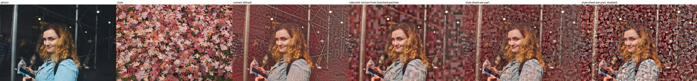

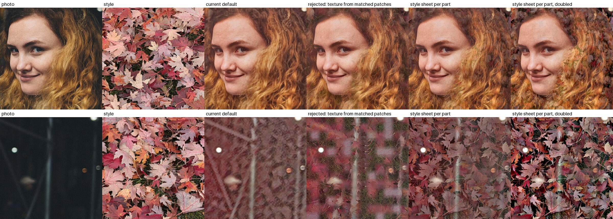

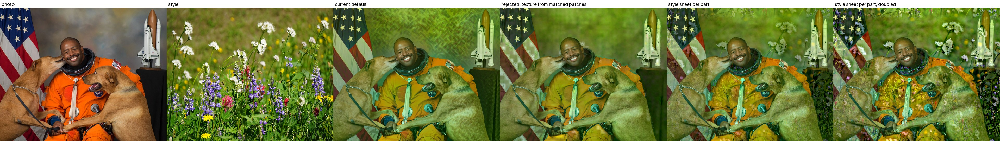

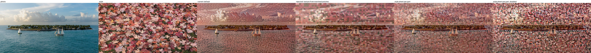

Also: [cat autumn](012-style-texture/cat_autumn.jpg) and close-ups for each pair in the same folder.

**Results: all 20 pairs.** Columns are the photo, the style, the default before this, the style sheet, and the style sheet doubled.

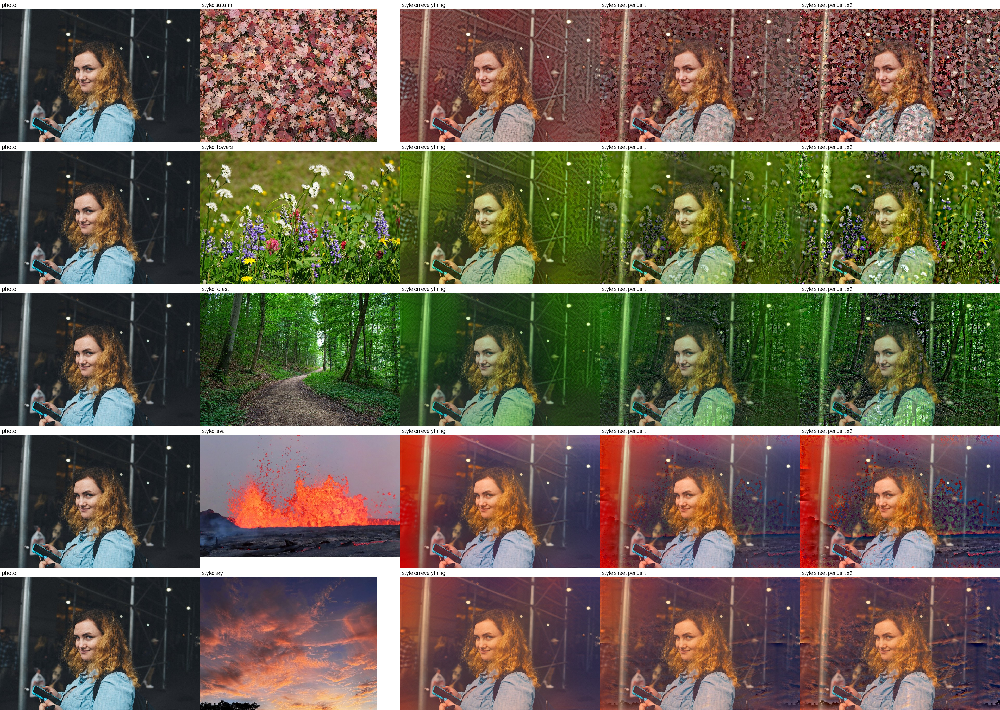

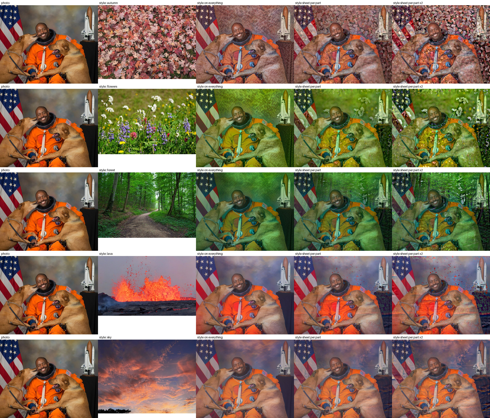

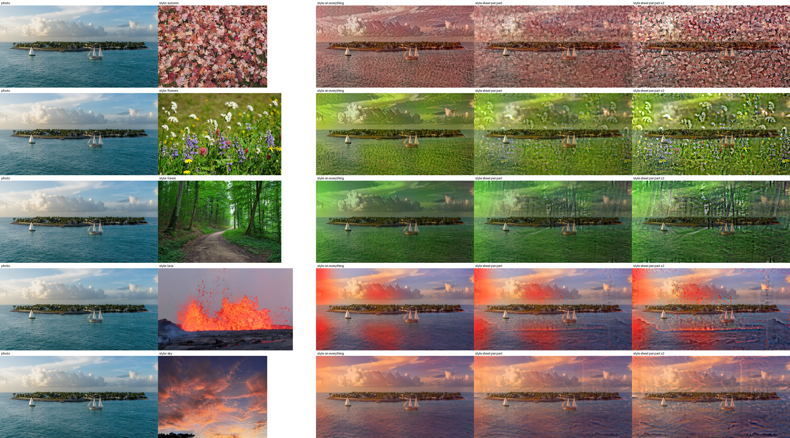

**What the images show**

- **With autumn and flowers, the style is finally recognisable from texture.** The portrait's background is made of maple leaves; real flowers appear behind the astronaut and on the woman's jacket.
- **Faces stay clean and sharp**, because skin receives almost none of the texture.
- **Outlines stay crisp to the eye.** The edge prominence number fell to 0.55 because it compares outlines with the clutter inside things, and real texture is clutter by that measure. The number needs rethinking; it no longer says what it was meant to.
- **The texture is flat.** It sits on each part like a printed pattern and does not bend with the surface or its shading.
- **Scene styles fail.** Lava adds scattered red dots and a stray horizon line. Sky adds faint streaks and, doubled, a visible band. Forest puts tree trunks across the harbour's sky. A scene is a picture of things, not a texture, so laying it over a photo gives a double exposure.
- **Doubled is too much.** Leaves cover the cat's face and bury the harbour's clouds.

**Conclusion.** The step works when the style is a dense, even texture and fails when the style is a scene. It is kept out of the default until the product can tell the two apart.

**Carried forward**

- Decide per style whether it is a texture or a scene: a texture looks alike in every quarter of the image, a scene does not. Texture styles get the sheet; scene styles keep the even tint.
- Make the sheet follow each object's shading, so it reads as the surface and not as a print on top.
- Replace the edge prominence number with one that measures outlines only.
- The code for the rejected patch method (`style_surface`, `from_surface`) was deleted from `model/enhance.py` at the start of experiment 013. It is in git history. Re-running `surface` no longer shows that column.

## 013: A new edge number, outline strength

**Goal.** A number we can trust for "each object still has a clear outline", so that texture can be added without the guard misfiring.

**What was wrong.** Edge prominence divided the contrast along the boundaries between things by the contrast inside them. Real texture inside an object counts as clutter by that measure, so the style sheet (012) scored 0.55 against the default's 0.88, though its outlines look just as crisp.

**The change.** Outline strength: the contrast across the photo's boundaries in the result, divided by the same in the photo. Both images are first flattened by the guided filter that `outline()` already uses, so fine texture inside things averages away. 1.0 means the outlines are as strong as in the photo. It replaces edge prominence in `measure`.

**How it was chosen.** Three ways of flattening were measured on all 20 pairs, next to the old number. A copy of the default blurred by about 2 pixels was added as a check: a good edge number must drop for it.

| Version | Old edge prominence | A: flattened, guided by the photo | B: flattened, guided by the result | C: not flattened |
|---|---|---|---|---|
| Raw SaMam | 0.59 | 0.79 | 0.84 | 0.92 |
| Subjects protected (009) | 0.87 | 0.89 | 0.83 | 0.89 |
| First try (010) | 0.86 | 0.92 | 0.87 | 0.92 |
| Default (010) | 0.88 | 0.81 | 0.71 | 0.82 |
| 4-pixel option (011) | 0.78 | 0.74 | 0.59 | 0.75 |
| Style sheet per part (012) | 0.55 | 0.82 | 0.74 | 0.86 |
| Style sheet per part, doubled | 0.40 | 0.83 | 0.78 | 0.89 |
| **Default, blurred** | **1.09** | **0.55** | 0.41 | 0.41 |

- **The old number was wrong in both directions.** It scored the blurred default higher than the sharp one, because blurring removes clutter faster than it weakens outlines.
- **C** rewards texture that reaches the outlines: the doubled sheet scores highest.
- **B** marks the default down for smoothing away outlines that have little contrast to begin with.
- **A** is kept. Adding texture leaves it almost unchanged (0.81, 0.82, 0.83), and blur lowers it clearly (0.81 to 0.55).

**What the new number says that the old one hid**

- **The default's outlines are weaker than the photo's (0.81).** The even tint and its partial flattening of light and dark reduce contrast across boundaries. "Subjects protected" keeps more of it (0.89). This is a real loss, and a candidate for a later step.
- **Raw SaMam's outlines are not weak (0.79).** Its problem was clutter inside objects, so that things merge (checklist Q3a). The new number does not measure that, by design. If merging returns as a problem, it needs its own number.

**Next.** Experiment 014: decide per style whether it is a texture or a scene.

## 014: Texture style or scene style

**Goal.** Give the style sheet (012) only to styles that are textures, so that scene styles stop producing a double exposure.

**What was wrong.** In 012, autumn leaves and flowers worked as a sheet. Forest put tree trunks across the harbour's sky, lava added red dots and a horizon line, and sky added faint streaks.

**First attempt: texture statistics per tile (not used).** The style is cut into a 4x4 grid, and each tile's texture statistics (the ones texture likeness uses) are compared with the whole image's. A texture should look alike in every tile.

| Style | Texture variation | By eye in 012 |
|---|---|---|
| autumn | 0.24 | works |
| forest | 0.56 | fails |
| flowers | 0.65 | works |
| lava | 0.82 | fails |
| sky | 0.96 | streaks |

It ranked flowers as more of a scene than forest. Weighting the tiles by how much texture they hold, so the flowers' blurred meadow counts less, gave the same 0.65: the flower tiles really do differ from each other (white umbels, purple lupins, plain leaves).

**The change: colour variation.** How far each tile's average colour is from the whole image's, relative to the image's overall colour spread. A bed of leaves has the same mix of colours everywhere. A scene has sky in one place, rock or trunks in another.

| Style | Colour variation | Share of the sheet it gets |
|---|---|---|
| autumn | 0.15 | 1.00 |
| flowers | 0.30 | 0.68 |
| forest | 0.40 | 0.32 |
| sky | 0.69 | 0 |
| lava | 0.80 | 0 |

The margin between flowers and forest is thin, so the share is a ramp (all of the sheet at 0.2 or less, none at 0.5) and not a cut-off. **The ramp's ends are set from these five styles.** That is a weak basis; the ten-style test set in step 5 of the stage plan is the real check.

**Measurements, all 20 pairs**

| Version | Texture likeness | Style on subjects | Outline strength | Blotchiness |
|---|---|---|---|---|
| Default (010) | 0.22 | 10.0 | 0.81 | 0.72 |
| Style sheet per part (012) | 0.34 | 10.1 | 0.82 | 1.30 |
| **Style sheet, by style** | 0.25 | 10.0 | 0.82 | 1.03 |

The average texture likeness falls from 0.34 because two of the five styles now get no sheet. Autumn pairs are the same as in 012.

**Results: all 20 pairs.** Columns are the photo, the style, the default, the style sheet from 012, and the style sheet by style.

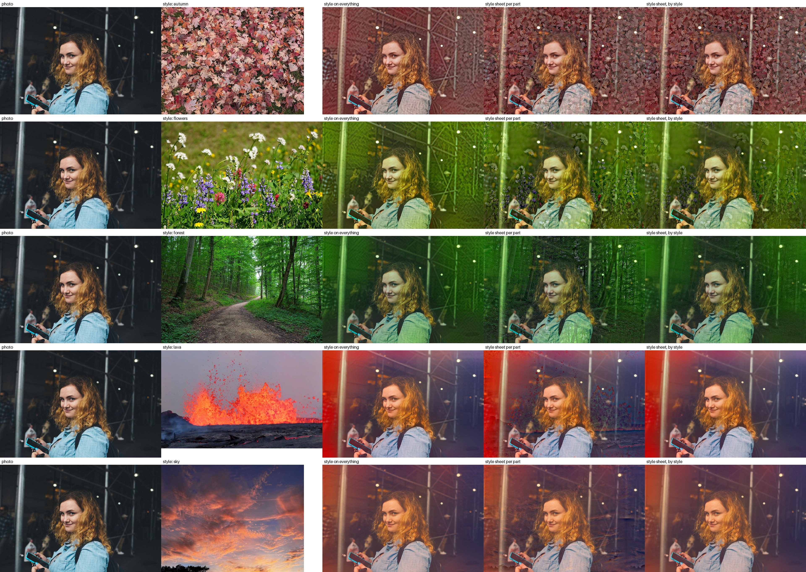

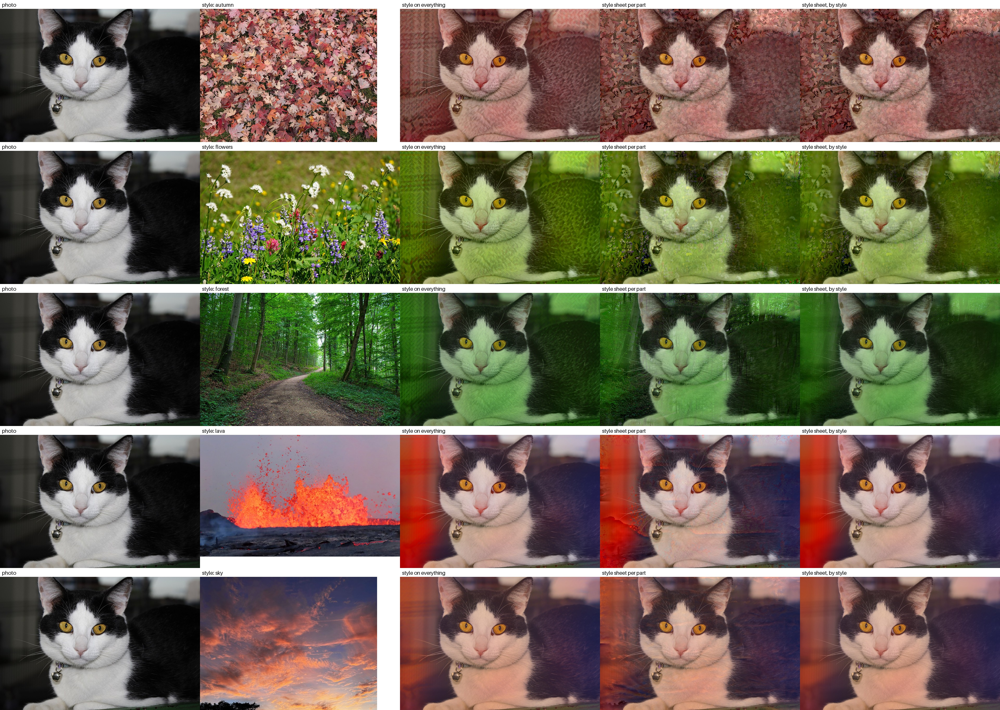

**What the images show**

- **Scene styles are clean again.** Lava and sky look exactly like the default. The forest's trunks are gone from the harbour's sky and the cat's background, and only faint vertical streaks remain at a third of the sheet.
- **Texture styles keep their texture.** Autumn is unchanged from 012. Flowers still show real flowers behind the portrait and the cat, a little more softly.
- **The lava style's large red patches are still there**, as in the default. They come from the model's tint, not from the sheet (stage plan step 2).
- **Blotchiness, 1.03, is above the guard of 0.8.** It counts everything between about 10 and 60 pixels across as a blotch, and a maple leaf is that size. It may need the same treatment as the edge number in 013: check that it scores a real blotch higher than real texture.

**Next.** Experiment 015: keep the photo's own colour mood, at the founder's request. Then the sheet following each object's shading (016).

## 015: Keeping the photo's colour mood

**Goal.** The founder asked (2026-10-03) that the result keep the photo's own prominent colours, so the overall mood of the photo does not change. The style should add itself without repainting the photo.

**What was wrong.** The style's colour replaces the photo's. Every flowers result is green and every autumn result red, whatever the photo looked like: a blue harbour turns green, a dark, cool portrait turns red.

**New number: colour shift.** How far the result's mix of colours is from the photo's, 0 to 100. Where the colours sit does not count, only which colours there are and how much of each (the average distance colours must move, along 16 fixed directions through colour space, to turn one mix into the other).

**Three ways, applied to the style sheet by style (014)**

| Version | How |
|---|---|
| A: each pixel's own colour | Each pixel gets the photo's colour back, keeping the result's brightness. The existing `keep_colour()`. |
| B: photo's palette | The result's colours are swapped, rank for rank along several directions through colour space, for the photo's, so the result has the photo's exact mix of colours (Pitie et al. 2005). |
| C: own colour and brightness | A, plus one tone curve that gives the result the photo's mix of light and dark. |

C was added after seeing A and B: A turned the portrait's dark background a washed-out grey, and B put colours in the wrong places.

**Measurements, all 20 pairs**

| Version | Colour shift | Style on subjects | Texture likeness | Outline strength | Blotchiness |
|---|---|---|---|---|---|
| Style sheet by style (014) | 12.2 | 10.0 | 0.25 | 0.82 | 1.03 |
| A: each pixel's own colour | 7.7 | 6.9 | 0.25 | 0.83 | 0.87 |
| B: photo's palette | 0.3 | 6.2 | 0.16 | 1.16 | 1.55 |
| B at half strength | 6.1 | 5.7 | 0.22 | 0.97 | 1.13 |
| **C: own colour and brightness** | **0.7** | 4.8 | 0.15 | 1.10 | 1.19 |

B scores near 0 on colour shift by construction: it is built to match exactly that. Style on subjects measures colour change, so any version that keeps the photo's colour lowers it; the guard of 10 was set when the style's colour was wanted on everything.

**Results: all 20 pairs.** Columns are the photo, the style, the style sheet by style, A, B and C.

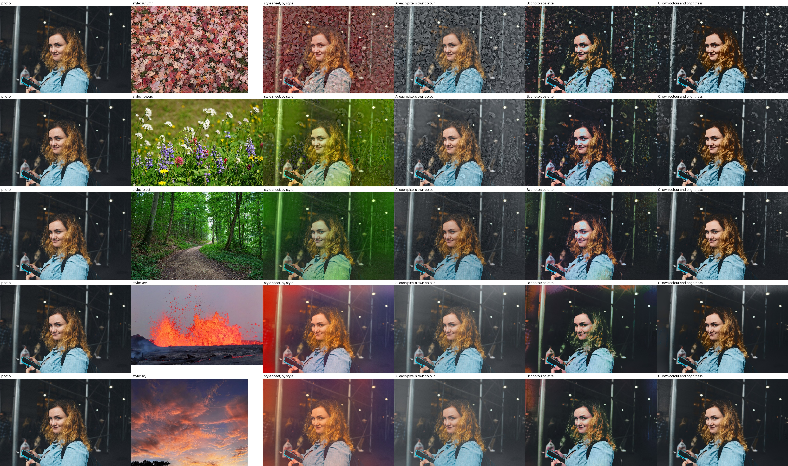

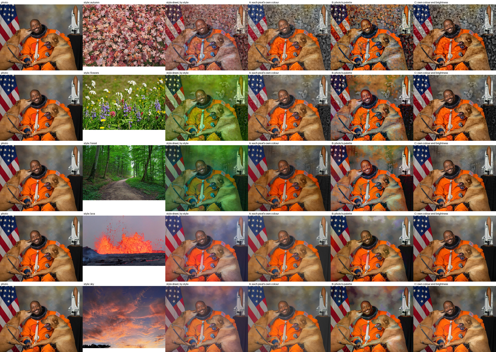

**What the images show**

- **C keeps the mood.** The portrait stays dark and cool, the astronaut's suit stays orange, the harbour stays blue. Faces, skin and fur are natural.
- **With autumn, C is a new look:** the photo made of leaves in its own colours (grey leaves on the astronaut's backdrop, dark leaves behind the woman). With flowers the shapes are fainter.
- **With lava, sky and forest, C is almost the photo.** These styles get little or none of the sheet (014), so their style was nearly all colour, and C removes the colour.
- **C's texture is weaker** (texture likeness 0.25 to 0.15): fitting the sheet into a dark photo's range of brightness squeezes its contrast.
- **A** keeps colour per pixel but not brightness: the portrait's black background turns mid-grey.
- **B is rejected.** Swapping colours by rank puts them in the wrong places: the woman's face and hair turn teal with lava and sky, the astronaut's face turns red with flowers, and patches of the flag's colours appear in backgrounds.

**Conclusion.** Keeping the photo's colour and keeping the style's colour pull against each other, and for scene styles the colour is most of the style. C is the right way to keep the mood when that is wanted. Whether it is the default, an option, or used partly (for example only with texture styles, or at a set strength) is the founder's decision. Code: `photo_brightness()` and `keep_colour()` in `model/enhance.py`; `photo_palette()` stays only to reproduce this entry.

## 016: The style's pattern, not the whole picture

**Goal.** Asked by the founder on 2026-10-03: take the style's detail in the pattern it comes in, and put that pattern on the photo, not the whole style picture.

**What was wrong.** The sheet (012) was the whole style image, so a scene style laid its trunks, horizon and sky over the photo. 014 avoided that by giving scene styles no sheet, so lava and sky arrived as colour only.

**The change.** `pattern_box()` picks the square of the style image (half its shorter side) that is most evenly full of fine detail. Each square is scored by the least detailed of the 3x3 cells inside it, so a square that runs into empty sky, a smooth trunk or a blurred meadow scores low. The sheet is built from that square, at full strength for every style.

**The squares chosen**

Autumn: anywhere, as expected. Flowers: the lupin and clover bed. Forest: the leaf canopy, with two thin trunks. Lava: the fountain, with a strip of rock along its lower edge. Sky: the densest clouds.

**Measurements, all 20 pairs**

| Version | Texture likeness | Style on subjects | Outline strength | Blotchiness | Colour shift |
|---|---|---|---|---|---|
| Default (010) | 0.22 | 10.0 | 0.81 | 0.72 | 12.3 |
| Sheet from the whole style (012) | 0.34 | 10.1 | 0.82 | 1.30 | 12.2 |
| Sheet by style (014) | 0.25 | 10.0 | 0.82 | 1.03 | 12.2 |
| **Sheet from the style's pattern** | **0.37** | 10.1 | 0.82 | 1.38 | 12.2 |

**Results: all 20 pairs.** Columns are the photo, the style, the sheet by style (014) and the sheet from the pattern.

Also: [cat](016-style-pattern/cat.jpg), [astronaut with dogs](016-style-pattern/astronaut_dogs.jpg).

**What the images show**

- **Scene styles now give a pattern, not a picture.** Lava gives spatter, not a horizon. Flowers fill the portrait's background with real lupins and clover.
- **The squares are not clean enough.** The forest's two trunks become vertical stripes across the harbour. Lava's strip of rock leaves short dark dashes where the tiles meet.
- **A small square repeats visibly.** In the harbour, the same yellow flowers form a regular grid.
- **The model's tint is still under everything,** including lava's large red patches. That is the next step.

**Next.** 017: put the pattern only on chosen parts, in its own colours, and keep the photo's colours elsewhere.

## 017: The pattern on chosen parts, in its own colours

**Goal.** The founder's direction (2026-10-03): put the style's pattern on chosen sections of the photo where it looks good, rather than colouring the entire photo. Everywhere else the photo keeps its own colours and mood.

**The change.** `placed_pattern()`. The pattern from 016 is laid on each part in its own colours, at the amount the existing per-part table gives (background 0.6, clothes 0.5, objects 0.35, hair 0.3, animals 0.25, skin 0.05), and kept off the outlines. The rest of the photo is untouched. **The model is not used at all:** no SaMam tint anywhere. The parts still come from the detectors.

**Measurements, all 20 pairs**

| Version | Style on subjects | Style on the rest | Texture likeness | Outline strength | Blotchiness | Colour shift |
|---|---|---|---|---|---|---|
| Default (010) | 10.0 | 14.1 | 0.22 | 0.81 | 0.72 | 12.3 |
| Sheet from the pattern (016) | 10.1 | 14.9 | 0.37 | 0.82 | 1.38 | 12.2 |
| **Pattern placed, photo's colours** | 4.5 | 15.6 | 0.32 | 0.87 | 2.73 | 9.5 |

- People, pets and objects change half as much as before (4.5), the rest slightly more (15.6). That is the intended split, but it fails the old guard of 10 on subjects, which was set for "style on everything". The guards need restating for this direction.
- Blotchiness 2.73 counts the pattern itself, and the repeated blocks, as blotches. It cannot tell them apart yet.
- Colour shift falls less than in 015 (9.5), because the background, often most of the picture, takes the pattern's colours.

**Results: all 20 pairs.** Columns are the photo, the style, the default, the sheet from the pattern (016), and the pattern placed in the photo's colours.

**What the images show**

- **On portraits this is the closest to the product idea yet.** The woman stands in her own colours in front of a flower meadow, a forest or a wall of lava. The astronaut's suit stays orange and the dogs brown in front of a forest or a lupin field. The model's red patches and green casts are gone.
- **Repetition is now the main flaw.** The harbour shows the same lupin and clover clusters in a regular grid; lava and sky show the square's edges as blocks and dashes.
- **Pets and clothes get a faint, dirty-looking pattern.** The cat's white fur looks speckled with autumn and lava.
- **A dark halo along outlines.** The strip kept free of pattern shows the photo's own dark background, as a band around the cat and the woman's hair.
- **Nothing is chosen on a landscape.** The harbour is all background, so sea and sky are covered completely.

**Next, one at a time**

1. Remove the repetition: a larger patterned area, or pieces of the pattern placed with variation instead of one square in a grid.
2. Choose where the pattern goes more carefully: background only by default, pets, skin and hair untouched, and on a landscape only some areas (the sky, or plain areas), not everything.
3. Close the halo: let the pattern run up to the outline, softly, instead of leaving a strip.
